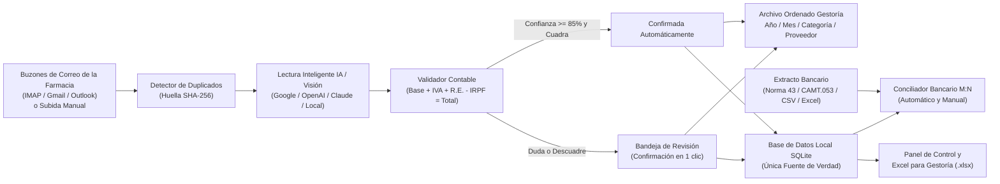

# Dossier de Presentación y Guía Completa del Proyecto
## Archivero — Gestión Inteligente de Facturas y Conciliación Bancaria para Farmacias

**Repositorio oficial:** [https://github.com/abel-eiras/archivero](https://github.com/abel-eiras/archivero)  
**Versión:** 0.1.0 · **Licencia:** MIT  
**Destinatarios:** Titulares de oficina de farmacia, personal de administración, gestorías farmacéuticas y colaboradores del proyecto.

---

## 1. Resumen Ejecutivo: El Problema y la Solución

### El día a día administrativo en la oficina de farmacia
Una farmacia recibe cada mes decenas de facturas por distintas vías: cooperativas de distribución diaria, laboratorios directos, suministros (luz, agua, fibra), alquiler del local (con retención de IRPF), servicios profesionales (asesoría, mantenimiento, seguros) y notas de abono por devoluciones o caducidades.

Hasta ahora, el titular o el personal de la farmacia tenía que:
1. Entrar correo por correo para descargar los PDFs adjuntos.
2. Renombrarlos a mano y colocarlos en carpetas para la gestoría.
3. Teclear importes en una hoja de cálculo para saber cuánto se ha gastado en el mes.
4. Puntear a mano el extracto del banco contra las facturas para descubrir si una remesa agrupaba tres facturas y descontaba un abono.

### La solución: Archivero
**Archivero** es una aplicación local instalada en el propio ordenador de la farmacia que automatiza todo este flujo de principio a fin, **sin cuotas de servidores externos, sin ceder las claves del banco y sin requerir conocimientos informáticos**.



---

## 2. Los 6 Principios Clave del Proyecto

| Principio | Qué significa en la práctica para la farmacia |
| :--- | :--- |
| **1. Cada farmacia es una isla** | No hay servidor central ni cuentas en la nube que mantener. Cada farmacia tiene su propia base de datos, sus propias claves y su propia carpeta en su ordenador. |
| **2. Privacidad en la red local** | El programa escucha exclusivamente en `localhost` (`127.0.0.1`). Ningún otro ordenador del mostrador ni de la red Wi-Fi de la farmacia puede cotillear el panel contable. |
| **3. Carpeta a prueba de despistes** | Los PDFs guardados en carpetas son una copia ordenada para la gestoría. Si alguien mueve, renombra o borra un PDF por error, **el programa y las estadísticas siguen funcionando intactos** porque todo reside en la base de datos interna (`SQLite`). |
| **4. Supervisión inteligente** | La Inteligencia Artificial ahorra el 95% del trabajo, pero cuando un documento viene borroso o los importes no suman bien, pasa automáticamente a la **Bandeja de Revisión** hasta que el farmacéutico lo confirma. |
| **5. Nada se pierde nunca** | Cada factura se escribe primero en una carpeta temporal segura, reintenta si el disco o Google Drive va lento, y antes de cada actualización del programa se hace una copia de seguridad automática de toda la base de datos. |
| **6. Cero acceso directo al banco** | El programa jamás pide las claves de la banca online. El farmacéutico descarga el fichero de movimientos (Norma 43, XML o Excel) y lo sube al programa en dos clics. |

---

## 3. Recorrido por las Pantallas de la Aplicación

### 3.1. Resumen General (Panel Principal)
Ofrece de un vistazo la salud económica de la farmacia:
- **Indicadores superiores (KPIs):**
  - *Gasto Total Registrado* (con desglose de Base sin IVA e IVA).
  - *Facturas Guardadas* (archivadas por Año / Mes / Categoría / Proveedor).
  - *Por Revisar* (acceso rápido a las facturas con algún dato dudoso).
  - *Pendiente de Pago* (importe total y número de facturas aún no conciliadas con el banco).
- **Gráficos integrados (100% locales, funcionan incluso sin Internet):**
  - Evolución del gasto mes a mes.
  - Desglose del gasto por tipo de compra (Mercancía, Suministros, Alquiler, Servicios profesionales, Material, Seguros, Impuestos).
  - Ranking de principales proveedores de la farmacia.
- **Alertas de tesorería:**
  - Tabla de **Próximos Vencimientos** (facturas que vencen en los próximos 15 días o que ya han vencido y siguen sin pagar).
  - Tabla de **Facturas Pendientes de Pago**.

---

### 3.2. Bandeja de Revisión (Control de Calidad en un Clic)
Cuando el validador detecta cualquier anomalía —por ejemplo, que `Base + IVA + Recargo de Equivalencia - IRPF` no coincide exactamente con el `Total`, que falta el NIF o que la seguridad de lectura es inferior al umbral configurado (85% por defecto)— la factura aparece aquí explicando en español claro qué hay que revisar.

Al pulsar **"Corregir / Ver PDF"**, se abre la ventana de revisión dividida en dos mitades:
- **Mitad izquierda:** Formulario con todos los datos extraídos y un **comprobador matemático en vivo** que se pone en verde en cuanto la suma de Base + IVA + Recargo - IRPF cuadra con el Total.
- **Mitad derecha:** El documento PDF original para consultarlo sin cambiar de ventana.
- **Aprendizaje automático:** Al marcar la casilla *"Clasificar siempre a este proveedor en esta misma categoría en el futuro"*, el programa aprende la regla para las siguientes facturas de ese proveedor.

---

### 3.3. Todas las Facturas y Archivo Automático para la Gestoría
Permite buscar en milisegundos cualquier factura por texto libre (nombre del proveedor, NIF, número de factura o notas), filtrar por mes, categoría, estado de revisión o estado de pago, y abrir el PDF original.

Simultáneamente, el programa mantiene ordenada la carpeta de salida para la gestoría con esta estructura fija:

```text
archivo_facturas/
└── 2026/
    └── 11-Noviembre/
        ├── compras_mercancia/
        │   ├── Distribuidora_Farmaceutica_Norte_S_Coop/
        │   │   └── 2026-11-02_Distribuidora_Farmaceutica_Norte_S_Coop_FRA-2026-1001.pdf
        │   └── Cooperativa_Farmaceutica_del_Sur_S_Coop/
        │       ├── 2026-11-05_Cooperativa_Farmaceutica_del_Sur_S_Coop_FRA-2026-1002.pdf
        │       └── 2026-11-08_Cooperativa_Farmaceutica_del_Sur_S_Coop_AB-2026-0045.pdf
        ├── suministros/
        │   └── Comercializadora_Electrica_Peninsular_S_A/
        │       └── 2026-11-10_Comercializadora_Electrica_Peninsular_S_A_FRA-2026-2050.pdf
        └── alquiler/
            └── Arrendamientos_Urbanos_Goya_S_L/
                └── 2026-11-01_Arrendamientos_Urbanos_Goya_S_L_ALQ-2026-011.pdf
```

---

### 3.4. Cuadrar con el Banco (Conciliación Bancaria Muchos-a-Muchos)
Diseñado específicamente para la casuística real de las farmacias españolas:

1. **Formatos bancarios admitidos:**
   - **Norma 43 de la AEB (`.n43` / `.txt`):** El estándar clásico de todos los bancos españoles.
   - **CAMT.053 (ISO 20022 `.xml`):** El estándar europeo moderno en formato XML.
   - **Excel (`.xlsx`) y CSV (`.csv`):** Con detección automática de columnas y guardado del mapeo por banco.
2. **Deduplicación total:** Cada movimiento bancario se registra con una huella única (`hash_movimiento`). Aunque el farmacéutico suba tres veces el mismo extracto mensual, nunca se duplicará ningún apunte.
3. **Cruce automático inteligente:**
   - Cruza importe, cercanía de la fecha del cargo a la fecha de vencimiento de la factura, nombre/NIF/número de factura en el concepto bancario y reglas aprendidas.
   - **Resuelve pagos agrupados y abonos:** Si una cooperativa gira un único recibo bancario de `-783,75 €` que corresponde a una factura de `888,25 €` menos un abono por devolución de `-104,50 €`, el motor detecta la combinación exacta y da por pagados ambos documentos automáticamente.
4. **Unión manual muchos-a-muchos:**
   - Permite seleccionar un movimiento del banco y marcar varias facturas, o pagar una factura grande en varios plazos mensuales.
   - Si existe una pequeña diferencia (por ejemplo, un descuento por pronto pago o comisión), permite guardar igualmente dejando anotada la diferencia pendiente y aprendiendo la regla `Concepto bancario → Proveedor`.

---

### 3.5. Exportación a Excel para la Gestoría
Con un solo clic en **"Descargar Excel para Gestoría"**, el programa genera al vuelo desde SQLite un libro `.xlsx` profesional con cuatro hojas:
1. **`Facturas Recibidas`:** Listado completo con Fecha Emisión, Vencimiento, Nº Factura, Proveedor, NIF, Categoría, Tipo de Documento, Base Imponible, IVA, Recargo de Equivalencia, IRPF, Total, Estado de Revisión, Estado de Pago, Importe Conciliado, Importe Pendiente y fila de sumatorios totales.
2. **`Resumen Mensual y Categorías`:** Cuadro de mando mensual y desglose por categorías de gasto.
3. **`Por Proveedor`:** Volumen facturado y número de facturas por cada proveedor y NIF.
4. **`Conciliación Bancaria`:** Relación de movimientos del banco, estado de conciliación y facturas imputadas a cada cargo.

---

## 4. Modelos de Inteligencia Artificial, Privacidad y Costes

Una duda habitual al implantar herramientas con IA es si hace falta pagar una suscripción de 20 €/mes (*ChatGPT Plus*, *Claude Pro* o *Gemini Advanced*). **La respuesta es no**: esas suscripciones son solo para chatear en la web, mientras que los programas utilizan **Claves de conexión (API Keys)** de pago por uso (o gratuitas), que resultan infinitamente más baratas para una farmacia:

| Opción en Configuración Fácil | Coste aproximado en una farmacia | Privacidad de los datos | Capacidad de lectura |
| :--- | :--- | :--- | :--- |
| **1. Google AI Studio (Nivel Gratuito)** | **0,00 € / mes** (hasta 1.500 facturas al día, sin tarjeta) | Google avisa de que puede usar los documentos para mejorar sus modelos | Excelente (lee PDFs digitales y escaneados por visión directa) |
| **2. Google AI Studio (Con facturación activada)** | **~0,02 € por cada 100 facturas** (menos de 0,50 € al año, sin cuota fija) | **100% Privado por contrato** (Google garantiza no usar los datos para entrenar) | Excelente (lee PDFs digitales y escaneados por visión directa) |
| **3. OpenAI (`gpt-4o-mini`)** | **~0,03 € por cada 100 facturas** (5 € de recarga duran más de un año) | **100% Privado por contrato** | Muy alta |
| **4. Anthropic (`Claude Haiku / Sonnet`)** | **~0,05 € por cada 100 facturas** | **100% Privado por contrato** | Excelente (lectura nativa de PDFs) |
| **5. Modo básico sin Internet / IA Local** | **0,00 € / mes** | **100% en el ordenador de la farmacia** (ningún dato sale a Internet) | Facturas con capa de texto digital o vía Ollama local |

> Además, la pantalla de **Configuración Fácil** incluye el botón **"Probar Clave"**, que realiza una lectura de prueba en un segundo y confirma al farmacéutico si su clave está lista para funcionar.

---

## 5. Arquitectura Técnica y Seguridad del Sistema

### Estructura del proyecto
```text
archivero/
├── app/
│   ├── main.py                  # Servidor local FastAPI (127.0.0.1) y ciclo de vida del worker
│   ├── config.py                # Constantes, categorías iniciales y configuración por defecto
│   ├── api/
│   │   └── routes.py            # Endpoints REST (Dashboard, Facturas, Banco, Correo, Ajustes, Excel)
│   ├── db/
│   │   └── database.py          # Capa SQLite (WAL), migraciones versionadas y backups automáticos
│   ├── models/
│   │   └── schemas.py           # Contratos de datos y esquemas Pydantic
│   ├── services/
│   │   ├── pdf_extractor.py     # Hash SHA-256, extracción pypdf, OCR local y preparación Visión
│   │   ├── llm_processor.py     # Proveedores Gemini, OpenAI, Anthropic y Heurístico + Validador
│   │   ├── storage.py           # Capa 1 (Carpeta Local con staging y reintentos) y Capa 2 (Google Drive API)
│   │   ├── pipeline.py          # Orquestador de ingesta de extremo a extremo
│   │   ├── credentials.py       # Almacén seguro de secretos (Keyring del SO + bóveda cifrada Fernet)
│   │   ├── mail_poller.py       # Conectores IMAP y OAuth2 (Gmail/Outlook) y vigilancia periódica
│   │   ├── bank_parsers.py      # Parsers de Norma 43 (AEB), CAMT.053 (ISO 20022 XML) y CSV/Excel
│   │   ├── reconciliation.py    # Motor de conciliación bancaria automática y manual muchos-a-muchos
│   │   ├── excel_exporter.py    # Generador del libro Excel contable multi-hoja desde SQLite
│   │   └── updater_service.py   # Consulta de releases en GitHub y verificación obligatoria SHA-256
│   ├── templates/
│   │   └── index.html           # Interfaz web en español adaptada a personal no técnico
│   └── static/
│       ├── styles.css           # Diseño visual limpio sin dependencias externas
│       └── app.js               # Lógica interactiva del panel, visor PDF y calculadora en vivo
├── scripts/
│   └── generate_sample_data.py  # Generador de facturas PDF realistas y extractos bancarios (Fase 0)
├── packaging/
│   ├── facturas_farmacia.spec   # Especificación PyInstaller para ejecutables Windows y Mac
│   ├── build_windows.bat        # Script de compilación y firma SHA-256 para Windows
│   └── build_mac.sh             # Script de compilación y firma SHA-256 para macOS / Linux
├── tests/                       # Suite completa de 14 tests automatizados (pytest)
├── updater.py                   # Actualizador independiente con espera de PID, verificación y rollback
├── Dockerfile                   # Contenedor opcional para despliegue aislado
└── docker-compose.yml           # Orquestación Docker vinculada a localhost
```

### Medidas de seguridad implementadas
1. **Cero contraseñas en la base de datos:** Las contraseñas de correo, tokens OAuth y claves de API se almacenan exclusivamente en el **Administrador de Credenciales de Windows** (*Credential Manager*) o **Llavero de macOS** mediante `keyring` (con bóveda cifrada `AES-128-CBC + HMAC` cuando se ejecuta en entornos sin escritorio).
2. **Aislamiento en red local:** El servidor web se vincula por defecto a `127.0.0.1` (`localhost`).
3. **Actualizaciones verificadas criptográficamente:** Antes de aplicar cualquier actualización desde GitHub Releases, `updater.py` comprueba que el hash `SHA-256` del ejecutable descargado coincida exactamente con el publicado en la release y realiza una copia de seguridad del ejecutable y de la base de datos.

---

## 6. Hoja de Ruta y Fases de Validación

| Fase | Estado | Alcance y Punto de Revisión |
| :--- | :---: | :--- |
| **Fase 0: Muestra de casos reales** | ✅ Completada | Generador de facturas variadas (con recargo de equivalencia, IRPF, abono y descuadre) y extractos en Norma 43, CAMT.053 y CSV. |
| **Fase 1: Núcleo de procesado** | ✅ Completada | Extracción de texto/OCR/Visión, llamada a IA (Gemini/OpenAI/Claude/Local) y validación aritmética y temporal. |
| **Fase 2: Base de datos y archivo** | ✅ Completada | Esquema SQLite versionado con backups automáticos, detección de duplicados por hash `SHA-256` y escritura atómica con reintentos. |
| **Fase 3: Módulo de correo** | ✅ Completada | Conexión multi-cuenta IMAP, deduplicación por `Message-ID`, filtrado por remitente o contenido y reglas automáticas. |
| **Fase 4: Interfaz web y ayuda** | ✅ Completada | Panel completo en español no técnico, Bandeja de Revisión con visor PDF, Configuración Fácil y Ayuda Paso a Paso. |
| **Fase 5: Empaquetado y actualizador** | ✅ Completada | Especificación PyInstaller para Windows/Mac, almacén seguro de credenciales y `updater.py` con verificación `SHA-256`. |
| **Fase 6: Conciliación bancaria** | ✅ Completada | Importadores Norma 43, CAMT.053 y CSV/Excel con mapeo, emparejamiento automático (incluyendo remesas y abonos) y manual M:N. |
| **Fase 7: Beta cerrado en farmacias** | 🚀 Listo para iniciar | Prueba real en 2–3 farmacias piloto para afinar categorías finales y reglas específicas. |
| **Fase 8 y 9: OAuth Correo y Drive API** | ✅ Soportado | Conectores `OAuth2MailConnector` (Gmail/Outlook XOAUTH2) y `GoogleDriveStorage` (API v3) integrados en la arquitectura. |
